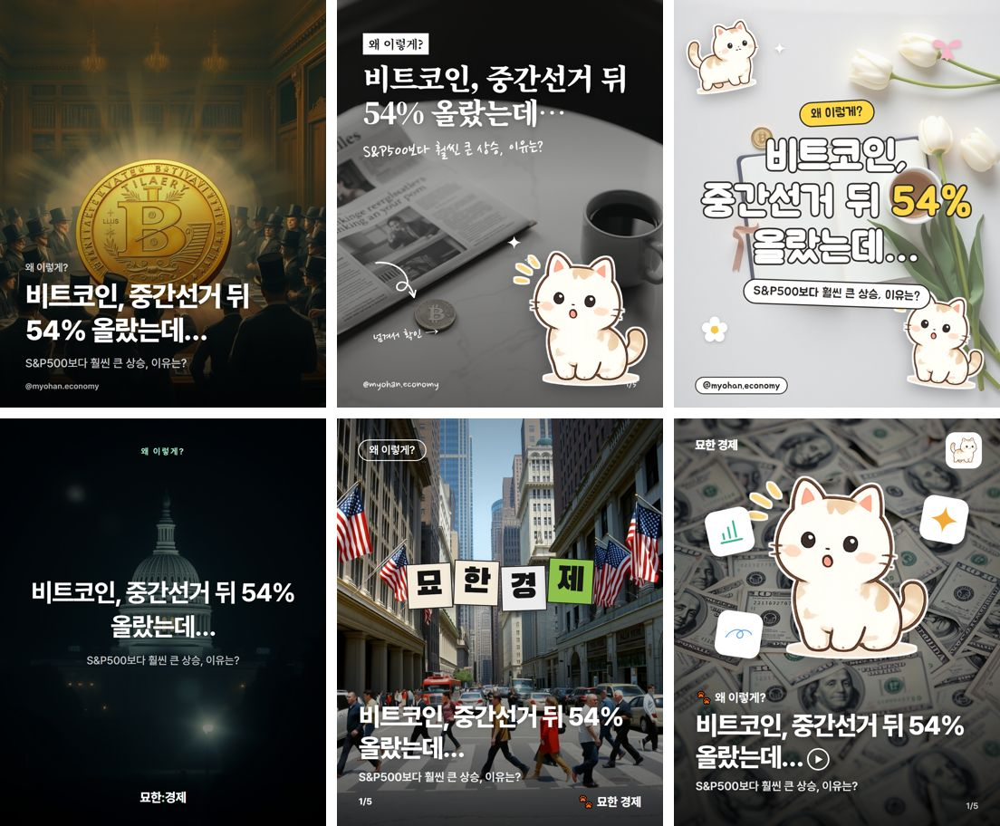

# 카드뉴스 템플릿 라이브러리

인스타그램 캐러셀(1080×1350, 4:5)용 디자인 템플릿 14종(사진형 6종 + 화면 UI형 3종 + 레퍼런스형 5종). "묘한 경제"뿐 아니라 다른
카드뉴스 프로젝트에서도 **같은 슬라이드 데이터로 템플릿만 바꿔** 쓰도록 만들었다.
여러 템플릿을 돌아가며 쓰는 것을 전제로, 모든 템플릿이 같은 슬라이드 스키마를 읽는다.

2026-10-29 운영자가 준 레퍼런스 6종을 바탕으로 제작. 미리보기는 `previews/`
(같은 주제 하나를 6종으로 렌더한 결과, `_covers.jpg`는 표지만 모은 것).



## 템플릿 목록

| 이름 | 레퍼런스 | 생김새 | 잘 맞는 주제 | 배경 이미지 |
|---|---|---|---|---|
| `gallery` | 세계문학 큐레이션 계정 | 명화·사진 풀블리드, 아래 그라데이션 위 흰 굵은 제목. 속지는 같은 그림을 흐리고 어둡게 깔고 내용 | 이야기·인용·한 문장 훅이 강한 주제 | 유화풍 명화(`gallery` 스타일) |
| `moody` | 무드 에디토리얼 피드 | 탈색한 감성 사진, 세리프 제목, 흰 하이라이트 박스, 손글씨 메모·화살표·반짝이, 흰 테두리 스티커 컷아웃 | 팁·습관·라이프스타일, 차분한 해설 | 회색 톤 생활 사진 |
| `sticker` | 옐로 스티커 피드 | 밝은 회색 사진, 테두리 두른 둥근 굵은 글씨(숫자는 노랑), 노란 알약 라벨, 흰 메모 카드, 리본·꽃·스티커 콜라주 | 가볍고 귀여운 톤, 체크리스트, 비교 | 밝은 플랫레이(가운데 여백) |
| `darkcenter` | De:part | 어두운 사진 + 가운데 흰 제목 + 위 작은 민트 라벨 + 아래 워드마크. 설명 장(point/quote/list)은 검은 바탕 흰 메모 카드·손글씨 | 생각·관점·브랜딩, 한 문장 메시지 | 어두운 시네마틱 사진 |
| `blocktitle` | 토스뱅크 시리즈 공지 | 다큐 사진 풀블리드, 글자 하나씩 색 블록 타일(표지는 워드마크, 속지는 숫자), 왼쪽 아래 흰 제목, 윤곽선 알약 라벨 | 시리즈물, 숫자가 핵심인 뉴스 | 거리·현장 스냅 사진 |
| `cutout` | 하나 IRP 숏폼 썸네일 | 질감 배경 + 가운데 큰 캐릭터·인물 컷아웃(흰 테두리) + 주변 아이콘 스티커, 아래 이모지 라벨·굵은 제목·재생 아이콘 | 금융 팁, 캐릭터·인물이 있는 브랜드 | 돈·소재 질감 클로즈업 |
| `chat` | MSMG 메신저 표지 | 검은 바탕 메신저 대화방. 표지는 말풍선(`hook`)·입력 중 표시·입력창 위 형광 태그와 큰 형광 제목, 속지는 질문(내 말풍선)과 답(상대 말풍선) | 테크, "그래서 뭐가 달라?"형 설명 | 쓰지 않음(검은 바탕) |
| `notify` | THICK. DM 표지 | 휴대폰 잠금화면. 색 그라데이션 배경화면(덱마다 4색 중 하나) + 날짜·큰 시계 + 알림 배너(`hook`) + 굵은 흰 제목, 속지는 상태 막대 아래 내용이 알림으로 도착 | 속보·발표·업데이트 소식 | 쓰지 않음(그라데이션) |
| `desktop` | iOS·폴더·AirDrop UI 콜라주 | 밝은 회색 바탕 컴퓨터 화면. 표지는 메뉴 막대·복사 팝업·블록 선택된 큰 제목·사진 창·폴더·목록(`hook`), 속지는 창·대화상자, 마지막 장은 "게시물 저장" 대화상자 | 기기·서비스·사용법 | 밝은 책상 사진 |
| `soft` | MSMG 앉은 자세·로코 여주 | 흰색→파스텔 배경(덱마다 4색 중 하나) + 가운데 누끼 사진 + 위 굵은 검은 제목(속지 ❶ 번호) + 아래 검은 테두리 흰 박스, 말풍선 라벨(kicker) | 팁·체크리스트·생활 변화 | 흰 배경 위 피사체(곱하기로 누끼처럼) |
| `magazine` | MORE THAN LOCAL | 사진 풀블리드 + 위 노란 타자체 vol.번호·시리즈 + 노란 네모 태그 + 중간 굵기 흰 제목, 오른쪽 아래 격자 로고 | 에디터 픽·리뷰·정리 | 에디토리얼 사진 |
| `folder` | What's inside this folder | 크림 바탕 + 작은 복사 팝업 + 얇은 산스·명조 제목 + 픽셀 커서 + 톤 다운 폴더·목록(`hook`) + 필름톤 사진 세 장(한 장을 세 구도로) + 폴더 앞면, 속지는 폴더에서 꺼낸 크림 종이 | 정리·모음·체크리스트 | 가로로 볼거리 많은 스냅 |
| `airdrop` | ELLA CONTENT CLUB a day in the life | 필름톤 사진 위 얇은 파일 공유 창 틀(반투명 머리말 + 거절/수락) + 흰·연분홍 산스/명조 제목 + 손글씨 키워드 스티커·연하늘 라벨 + 손그림 반짝이 + 반투명 독, 속지는 흐린 사진 위 크림 창 | 가벼운 생활 테크, 신기능 소개 | 일상 스냅(폰·커피) |
| `edit` | Everyday Edit / iOS Core Collection 피드 | 따뜻한 필름톤 사진 + 얇은 산스·명조 흰 제목 + 영문 필기체 장식 + 작은 말풍선·손글씨 영수증 메모(`hook`), 속지는 크림 종이 위 작은 사진 액자와 차분한 글씨 | 라이프스타일 톤의 테크 소식 | 필름톤 라이프스타일 사진 |

## 마스코트 있음 / 없음 버전

`chat`·`notify`·`desktop`·`soft`·`magazine`·`folder`·`airdrop`·`edit`은 마스코트를 쓰지 않는다. 아래는 사진형 6종.

모든 템플릿은 두 버전으로 쓸 수 있다. 템플릿 이름 뒤에 `:plain`을 붙이면 마스코트 없는 버전이다(예: `moody:plain`).

| 템플릿 | 마스코트 있음 | 마스코트 없음(`:plain`) |
|---|---|---|
| `gallery` | 표지·마지막 장 오른쪽 아래 스티커 | 그림과 글자만 |
| `moody` | 오른쪽 아래 큰 스티커 컷아웃 | 손그림 반짝이를 키워 자리를 채움 |
| `sticker` | 모서리 스티커 1~2개 | 꽃·리본·반짝이 콜라주만 |
| `darkcenter` | 워드마크 위 작은 스티커(표지·숫자·마지막 장) | 글자만 |
| `blocktitle` | 표지 타일 옆·숫자 장 오른쪽 위 스티커 | 사진·타일만 |
| `cutout` | 가운데 큰 캐릭터 컷아웃 | 아이콘 스티커 3개를 크게 모아 가운데를 채움 |

## 가독성 규칙 (템플릿이 보장하는 것)

- 제목·인용·큰 숫자는 슬라이드 데이터의 줄바꿈(`\n`)대로만 줄을 나눈다. 한 줄이 칸을 넘으면
  글자 크기를 줄여 맞춘다(`_shared/engine.js`의 `fitDeck`). 의미 단위 줄바꿈이 깨지지 않게 하려는 것.
- 그래서 내용 쪽에서 제목을 한 줄 12자 안팎으로 끊어 줘야 한다(`slide_writer.py`가 13자 넘는 줄을 거른다).

## 슬라이드 스키마 (모든 템플릿 공통)

슬라이드 수와 종류는 고정하지 않는다. 내용에 맞게 3~7장을 고른다. 첫 장은 `cover`.

| kind | 필드 | 용도 |
|---|---|---|
| `cover` | `title`, `kicker?`, `subtitle?`, `hook?` | 표지. 제목은 궁금증을 만드는 한 문장. `hook`은 UI형 템플릿이 말풍선·알림·목록으로 얹는 짧은 대화 2~3줄(각 24자 이내), 사진형은 무시 |
| `stat` | `value`, `label`, `note?`, `kicker?` | 숫자 하나로 말하는 장 |
| `compare` | `title?`, `items[{label, value}]`, `note?` | 두세 값 나란히 비교 |
| `point` | `title?`, `body`, `kicker?` | 문장으로 설명(2문장 이내) |
| `list` | `title?`, `items[]`, `kicker?` | 짧은 항목 2~4개 |
| `quote` | `quote`, `source?` | 인용·핵심 한 줄 크게 |
| `closing` | `title`, `body?`, `kicker?` | 마지막에 남길 한 줄 |

권장 글자 수: 제목 24자(한 줄 12자), kicker 12자, body 90자(문장 2개, 문장당 40자), list 항목 28자, quote 50자.

### 장식 문구 `props` (덱 최상위, 선택)

카드 속 UI 소품의 글자(창 제목, 버튼, 필기체 장식, 폴더 이름 등)는 고정 문구를 매번 되풀이하지 않도록 덱마다 내용에 맞춰
새로 짓는다. 없거나 조건에 안 맞는 항목은 `slide_writer.clean_props`가 버리고 템플릿 기본값이 들어간다.

| 키 | 길이 | 쓰는 템플릿(기본값) |
|---|---|---|
| `script` | 영어 소문자 22자 | edit 표지(today's edit), folder 표지(what's inside) |
| `closing_script` | 영어 소문자 22자 | edit 마지막 장(saved for later) |
| `window_title` | 10자 | airdrop 창 제목(파일 공유) |
| `buttons` | 2개 × 6자 | airdrop 창 버튼(거절/수락) |
| `closing_buttons` | 2개 × 6자 | airdrop 마지막 장(나중에/저장하기), desktop 마지막 대화상자(저장 안 함/게시물 저장) |
| `memo_title` | 8자 | edit 영수증 메모(오늘의 메모) |
| `folders` | 2개 × 8자 | folder 폴더 이름(최종/진짜_최종), desktop 둘째 폴더 |
| `label` | 8자 | airdrop 키워드 라벨(오늘의 키워드) |
| `ask` | 16자 | chat 마지막 장 질문 말풍선(그래서 한 줄로 요약하면?) |

숫자는 원문에 있는 것만, 금지 표현·한자 없음(슬라이드와 같은 기준). 필기체 글꼴(Allura)은 한글이 없어 `script`류는 영어만.
제목·인용은 `\n`으로 의미 단위 줄바꿈을 넣는다. 넘치면 `render.js`가 overflow를 출력하고 종료 코드 2로 끝난다.

## 브랜드 설정 (`brands/*.json`)

```json
{
  "name": "묘한 경제", "handle": "@myohan.economy", "wordmark": "묘한 경제",
  "series": "숫자로 보는 경제", "emoji": "🐾",
  "mascots": { "default": "...png", "cover": "...png", "stat": "...png", "closing": "...png" }
}
```

- `mascots`는 투명 PNG 경로(브랜드 파일 위치 기준). 슬라이드 종류별로 다른 포즈를 쓰고, 없으면 `default`.
  `moody`·`sticker`·`cutout`이 흰 테두리 스티커로 얹는다. 마스코트가 없는 브랜드는 비워두면 장식만 남는다.
- `wordmark`는 `darkcenter` 아래 로고, `blocktitle` 표지 타일, `cutout` 왼쪽 위 로고에 쓰인다.
- `series`는 kicker가 없는 장의 라벨(`darkcenter` 위 라벨, `blocktitle` 알약)로 쓰인다.

## 렌더하기

준비: Node + Playwright(이 저장소는 `~/.cardnews-deps`에 설치), Python + Pillow.

```bash
# 1) 배경 이미지 (Cloudflare Workers AI flux-1-schnell, 템플릿별 사진 톤을 자동으로 붙임)
python card_templates/images.py "<장면 설명(영어)>" out/img gallery moody

# 2) 브랜드 + 슬라이드 + 배경 → PNG 01~NN + 미리보기 sheet.jpg
python card_templates/make_job.py <template> deck.json card_templates/brands/myohan.json out/img/bg-<template>.jpg out/<template>
```

`deck.json`은 `{ "slides": [...] }`만 있으면 된다. 묘한 경제는 `slide_writer.py`가 기사 원문에서 만든다.

## 새 템플릿 추가

1. `card_templates/<이름>/template.html`을 만든다. `../_shared/base.css`와 `../_shared/engine.js`를 불러온다.
2. CSS로 `.kicker .title .subtitle .value .label .note .body .compare .items .quote .foot` 모양을 정한다.
3. 필요하면 `window.TEMPLATE`에 훅을 둔다:
   - `deco(slide, ctx)`: 슬라이드 전체 위에 얹을 장식(스티커·라벨·타일). `ctx.mascot`, `ctx.doodles`(손그림 SVG), `ctx.brand`
   - `content(slide, ctx, base)`: 기본 본문 HTML(`base(slide)`)을 감싸거나 바꾸기
   - `value(text, small)`: 숫자 표시 방식(예: 블록 타일)
   - `variant(slide, ctx)`: 슬라이드에 붙일 추가 클래스(예: 메모 카드 변형)
   - `foot(slide, ctx)`: 아래 줄(핸들·페이지·로고)
4. 위치를 잡는 요소는 `.content` 안이 아니라 `deco`에 넣는다(`.content`가 기준이 되면 슬라이드 밖으로 밀려남).
5. 같은 `deck.json`으로 렌더해 `previews/`에 시트를 추가한다.

## 알려진 한계

- 배경은 AI 생성이라 동전·신문 같은 소품에 읽을 수 없는 가짜 글자가 생길 수 있다. 큰 글자가 보이면 다시 생성.
- 글꼴은 Pretendard(jsDelivr)와 Google Fonts(Noto Serif KR, Nanum Pen Script, Jua, Black Han Sans)를 네트워크로 불러온다.
  렌더 환경에 인터넷이 없으면 대체 글꼴로 나온다.
- 손글씨(Nanum Pen Script) 본문은 90자를 넘기면 답답해진다. `moody`·`darkcenter` 메모 카드는 짧게.
